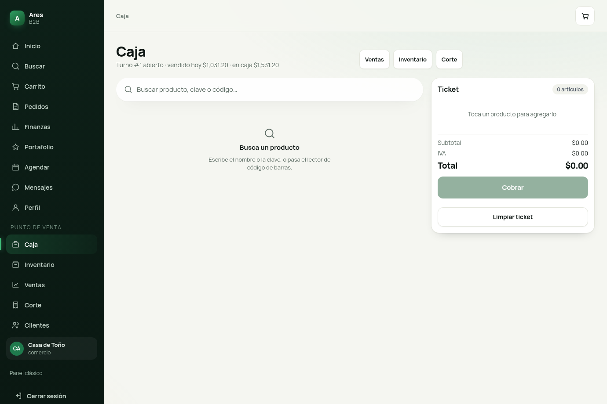

# Ares React

[](https://github.com/KAizuto846/ares-b2b/actions/workflows/ci.yml)


Reescritura completa de la interfaz de Distribuidora como **SPA de React** sobre una **API JSON** que reutiliza el dominio ya probado (precios por escala, IVA, reservas de stock, checkout idempotente).

Corre aparte del panel viejo: **puerto 8081**, cookie de sesión propia y sin tocar el servicio de producción, pero sobre la misma base de datos.



## Estructura

```
ares-react/
├── backend/            copia del PHP actual + app/Api/*.php (API JSON por módulos)
│   ├── public/api.php  despachador de /api/*
│   ├── server.php      router de php -S: /api → JSON, resto → SPA
│   └── public/spa/     build de Vite (generado)
├── frontend/           Vite + React 19 + TypeScript + React Router
│   └── src/
│       ├── styles/     app.css (sistema visual) + mod-*.css por módulo + gate.css
│       ├── store/      sesión, carrito, avisos
│       ├── components/ Shell (rail, topbar, cajón), Icon, UI
│       └── pages/      una carpeta por módulo
└── qa/                 Playwright: paridad, desbordes y humo de interacción
```

## Correr

```bash
cd frontend && npm install && npm run build
cd ../backend && ~/.local/php-static/php -S 127.0.0.1:8081 -t public server.php
```

<http://127.0.0.1:8081/spa/>

## Despliegue

Servicio de usuario (arranca solo, sobrevive al cierre de sesión):

```bash
systemctl --user enable --now ares-react.service
```

Expuesto por Tailscale Funnel, junto al panel viejo:

- SPA: <https://riz0308.tail0820b4.ts.net/spa/>
- API: <https://riz0308.tail0820b4.ts.net/api/...>
- Panel PHP anterior: <https://riz0308.tail0820b4.ts.net:8443/>

## API

Todas las rutas devuelven `{ok:true,...}` o `{ok:false,error:{code,message}}`, y se declaran por módulo en `backend/app/Api/`:

- `auth.php` — sesión, alta, recuperación, verificación, legales
- `comercio.php` — inicio, buscador, carrito, checkout, pedidos, portafolio, agendar
- `catalogo.php` — productos, precios por escala, importación CSV, facturación
- `pos.php` — turno, venta, inventario, corte, clientes
- `finanzas.php` — gastos, facturas, exportación
- `mensajes.php` — hilos y notificaciones
- `perfil.php` — ficha, edición, seguridad, permisos, KYC
- `admin.php` — usuarios, reclamos, parámetros e historial, post-MVP
- `reparto.php` — entregas, seguimiento, incidencias
- `proveedor.php` — ficha pública del mayorista

La sesión es la misma del panel: `Session::iniciar()` sobre HTTP usa la cookie `didi2_sess`, que no colisiona con `__Host-didi2` de producción (HTTPS).

## Diseño

- Tokens en `:root` (color, forma, sombra, curvas de easing) y una hoja base para todo el sistema.
- Rail oscuro de 236 px con etiquetas; en móvil se convierte en barra inferior.
- Animaciones: entrada escalonada de tarjetas (`--i`), transición de ruta, cajón con `cubic-bezier(.16,1,.3,1)`, partícula de vuelo al carrito, esqueletos con shimmer.
- Todo respeta `prefers-reduced-motion`.

## Estado

Paridad completa con el panel PHP: **52 rutas** repartidas entre comercio, mayorista, repartidor y admin, incluidas POS con turno y corte, finanzas con exportación, mensajería, KYC, administración de usuarios/parámetros y páginas legales.

## Verificación

```bash
cd qa
node paridad.cjs                # 52 rutas de las 4 cuentas: desbordes, errores, textos y objetivos táctiles
node paridad.cjs todos --movil  # lo mismo a 390 px
node humo.cjs                   # interacción real sin escribir en la base
```

Último resultado: 0 errores de consola, 0 desbordes, 0 textos por debajo de 12 px y 0 controles por debajo de 44 px en escritorio y móvil.
